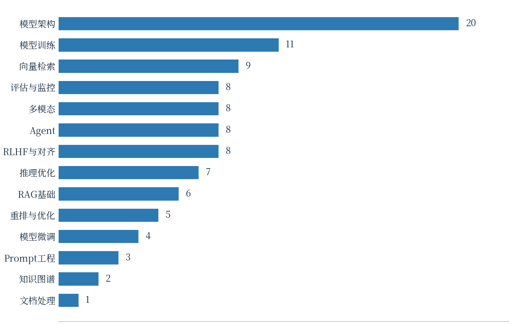
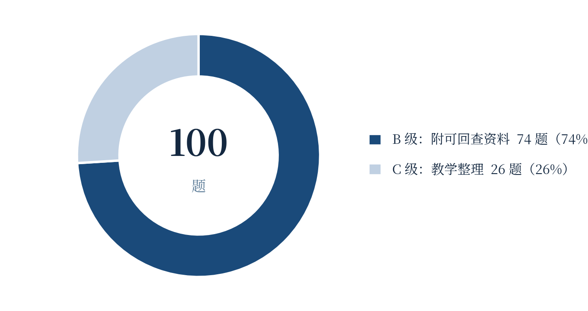

# llm-interview-questions 项目评估与实验手册

> **等效说明**：本文档是同名 PDF 手册（24 页 A4，见本仓库 Releases）的完整 Markdown 版本，内容与 `scripts/report_content_a.py`、`scripts/report_content_b.py` 生成管线一致。浓缩版结论记录见 [项目评估与一月实验计划.md](./项目评估与一月实验计划.md)。
> **评估对象**：`MisterBooo/llm-interview-questions`（main @ `320048c`，CC BY-SA 4.0）
> **评估日期**：2026-10-25 · **编制**：Z.ai（与 dongf9527 协作）
> **适用读者**：计划在一个月内系统学习大模型工程知识、有 Python/PyTorch 基础的在校学生

---

## 第一章 执行摘要

llm-interview-questions 是程序员吴师兄（GitHub ID：MisterBooo）于 2026 年开源的中文大模型面试知识库，定位是「100 道大模型面试题与 100 张 SVG 概念图」。它把大语言模型工程面试涉及的知识面拆解为 14 个模块，每道题由「题面、30 秒直接回答、追问方向、概念图解、参考资料、复核日期与来源等级」六要素构成，并配套一套基于文件哈希的内容复核机制。与常见的题库堆料不同，该项目更像一张经过整理的 LLM 工程知识地图：题目按主题组织、答案按可信度分级、资料可回溯到论文与官方文档，适合作为系统性学习与复习的骨架。

**100** 道面试题 · **100** 张 SVG 图解 · **14** 个知识模块 · **74%** B 级可回查 · **115** 篇 arXiv 引用

### 1.1 三个核心结论

- **结论一：它是一张高质量的知识地图，而不是一本教材。**GitHub 仓库内每题只保留约 50 字的「30 秒回答」摘要与图解，完整答案、口语讲法与追问链路放在作者官网。因此它的正确用法是「以题带点、按图索骥」的复习主线与检索索引，而非从零学习的教程；深度需要配合论文、官方文档与动手实验补齐——这正是本手册后面四章实验设计的出发点。
- **结论二：质量控制机制是同类项目中少见的亮点。**项目公开了逐题复核清单（review-manifest.json），对每道题的答案与图解分别记录 SHA-256 哈希；内容分为 B 级（附论文或官方文档等可回查资料，共 74 题）与 C 级（教学整理，共 26 题），并明示最近一次一致性初审日期。这套「可验证、可勘误、可追溯」的做法，让它在中文面试题库这个普遍「抄来抄去、无出处」的品类里显著更可信。
- **结论三：对求职学生而言，其最大价值是同时提供了「考点清单」与「实验清单」两个维度。**题目覆盖面试高频考点，图解适合快速建立结构；但面试官越来越倾向追问「你实际动手做过吗」。**因此本手册设计了 13 个 Colab 实验 + 1 个旗舰评测项目**，把纸面知识转化为可写进简历的工程证据，并将仓库题目二次开发为 LLM 评测集，一举覆盖系统学习、动手实验与二次开发三个目标。

### 1.2 本手册的结构与用法

本手册面向计划在一个月内（每天 1 至 2 小时，周末可加码）系统学习大模型工程知识、并有一定 Python 与 PyTorch 基础的在校学生。第二章给出对项目本体的事实性评估，包括内容结构、质量控制与优劣势对比，帮助您判断它与个人需求的匹配度；第三章回答「如何利用」，覆盖系统学习、面试复习与二次开发三条路径，并给出评测集、间隔复习卡等四个衍生方向的落地方案；第四章至第八章是手册主体——一份以周为单位、以 Colab 免费版 T4 GPU 为实验环境的分阶段实验手册，每周对应仓库的一个主题板块，共 13 个实验，每个实验给出目标、对应题目、步骤、代码骨架与检查点；第九章讨论风险、时间裁剪与求职衔接。建议先通读第一、二章建立全局认知，再按周推进实验，每周日开始本周计划、周六复盘并沉淀笔记。

## 第二章 项目全景评估

本章从项目背景、内容结构、质量控制、优劣势与同类对比五个维度，对该仓库做一次事实层面的全景评估。所有数据基于 2026 年 10 月对仓库的克隆分析：100 道题目、14 个模块文件、100 张 SVG 图解、review-manifest.json 复核清单全部逐一统计。

### 2.1 项目定位与作者背景

作者吴师兄是中文算法学习圈的知名作者，其 LeetCodeAnimation 项目以动画形式讲解 LeetCode 算法题，在 GitHub 累计获得约 76,700 个 star，是中文编程社区历史上传播最广的算法学习项目之一；他还维护面向检索增强生成的 RAG From Zero 教程仓库。llm-interview-questions 延续了其「图解 + 分步拆解」的方法论，把载体从算法动画换成 SVG 静态概念图，把主题从数据结构算法换成大模型工程。从仓库徽章看，作者同时运营一个包含 851 道题的完整付费题库网站，本仓库的 100 题是其中经筛选的免费子集，并带有官网引流链接。这一背景意味着两件事：其一，内容生产有成熟的流程与作者信誉背书，质量下限较高；其二，GitHub 仓库本质上是「目录 + 摘要 + 图解」的开放层，完整深度内容需要到官网获取，使用者应对这一边界有清晰预期。

项目采用 CC BY-SA 4.0 许可，允许署名转载与改编，衍生内容需采用相同许可，这为教育场景下的二次开发留出了合法空间（详见 3.3 节）。截至评估日，仓库 star 数约 74、fork 数 2，属于刚起步但内容密度较高的新项目；其内容最近一次一致性初审日期为 2026 年 7 月 19 日。

### 2.2 内容结构分析

14 个模块覆盖了当前大模型应用工程师岗位面试的主流考察面，可归并为五大板块：模型基础（模型架构 20 题、模型训练 11 题，合计 31%）、对齐与微调（RLHF 与对齐 8 题、模型微调 4 题）、检索增强（RAG 基础 6 题、向量检索 9 题、重排与优化 5 题、文档处理 1 题、知识图谱 2 题，合计 23 题）、智能体与工程化（Agent 8 题、推理优化 7 题、Prompt 工程 3 题），以及评估与多模态（评估与监控 8 题、多模态 8 题）。从题量分布看，模型架构一枝独秀，RAG 全链路合计占比次之，这与国内 LLM 应用岗位的实际考察频率基本吻合。



每道题的条目结构高度统一，由六个部分构成：一是题面本身，绝大多数是面试现场的真实问法（如「Decoder-only 架构为何是主流」「LoRA 微调比全量微调更慢吗」）；二是 30 秒回答，约 50 字的结论式摘要，适合考前快速过载；三是继续追问方向，提示面试官常见的二连问、三连问；四是 SVG 概念图，将答案的关键要素与关系可视化；五是参考资料列表，B 级题目附 arXiv 论文或官方文档直链；六是元信息，包括复核日期、来源等级与官网完整答案入口。这种结构对复习非常友好：第一遍看图与摘要建立框架，第二遍读参考论文补深度，临考前只刷 30 秒回答即可。

| 板块 | 模块 | 题数 | 对应实验周 |
|------|------|-----:|-----------|
| 模型基础 | 模型架构 + 模型训练 | 31 | 第 1 周 |
| 对齐与微调 | RLHF 与对齐 + 模型微调 | 12 | 第 3 周 |
| 检索增强 | RAG 基础 / 向量检索 / 重排 / 文档处理 / 知识图谱 | 23 | 第 2 周 |
| 智能体与工程化 | Agent / 推理优化 / Prompt 工程 | 18 | 第 4 周 |
| 评估与多模态 | 评估与监控 + 多模态 | 16 | 第 4 周（部分第 2 周） |

表 1 五大板块与手册实验周的映射关系

### 2.3 质量控制机制：B/C 分级与哈希闸门

该项目最值得同类学习的是其内容治理机制。首先，每道题被标注来源等级：B 级表示附有论文、官方文档或其他可回查资料（共 74 题，占比 74%），C 级表示当前没有独立来源链接的教学整理（共 26 题），且 README 明确承诺「不把 C 级内容包装成可核验的公司面试原题」，这是对题库品类普遍存在的「fake 原题」问题的正面回应。其次，仓库根目录的 review-manifest.json 为全部 100 题维护了逐题条目，记录答案哈希、原始图解哈希与发布图解哈希三类 SHA-256 值——一旦官网答案或图解发生变化，发布检查即可通过哈希不一致感知并触发重新复核。再次，项目配套了 REVIEW_POLICY.md（复核办法）、CORRECTIONS.md（勘误提交指引）与贡献指南，形成了「复核—发布—勘误」的闭环。



这套机制对使用者的直接意义是：引用该仓库内容备战面试时，可以区分「有论文支撑的结论」与「教学整理的说法」，在面试中给出出处能显著提升可信度。对二次开发者而言，B 级条目自带的 115 篇去重 arXiv 引用与官方文档链接，本身就是一份高密度的 LLM 工程阅读清单，可直接作为评测集的参考答案来源与难度标注依据。

### 2.4 优势与局限

综合以上分析，该项目的优势集中在「结构与治理」，局限集中在「深度与广度的不均匀」。下表给出六个维度的正反对照，帮助您在利用时扬长避短。

| 维度 | 优势 | 局限 |
|------|------|------|
| 知识组织 | 14 模块分类清晰，题目即考点，30 秒回答 + 图解 + 追问三层信息递进 | 无难度分级与学习顺序建议，新手难以判断先学哪个模块 |
| 可信度 | B/C 来源分级 + 哈希闸门 + 勘误流程，74% 题目可回查论文 | 26% 为教学整理；图解为「快速建立结构」之用，不能替代原文 |
| 深度 | 每题附 2-4 篇精选论文（LoRA、FlashAttention、DPO 等一手来源） | GitHub 端仅 50 字摘要，完整答案需至作者官网，部分内容疑似引流付费 |
| 广度 | 覆盖架构、训练、RAG、Agent、多模态、评估等主流面试面 | 模块间题量失衡：模型架构 20 题，文档处理仅 1 题、知识图谱仅 2 题 |
| 形式 | SVG 矢量图可缩放、可嵌入幻灯片，适合教学分享 | 纯静态，无交互式练习、无自测与间隔复习机制，需自建 |
| 工程性 | 仓库结构规整（modules/ + images/ + manifest），易于脚本化解析 | 无可运行代码，所有动手价值需使用者自行补齐（本手册解决） |

表 2 六维度优劣势对照

### 2.5 与同类学习资源对比

把该仓库放回您的备考工具箱中，它并不能替代任何一类既有资源，而是承担「索引与骨架」的角色。下表将其与四类常见资源对比。结论是：以本仓库为复习主线与考点索引，以论文与官方文档补深度，以本手册的实验补工程证据，三者互为补充。

| 资源 | 代表 | 强项 | 弱项 | 与本仓库关系 |
|------|------|------|------|-------------|
| 开源题库 | 本仓库；AILLM InterviewQuestions 等 | 中文、按主题组织、附图解与来源分级 | 答案深度有限、无代码 | —— |
| 算法题库 | LeetCode、LeetCodeAnimation | 工程编码能力、手写代码面试 | 不含 LLM 原理与应用层 | 求职互补：一个练编码一个练原理 |
| 官方文档 | HuggingFace、vLLM、PEFT 文档 | 工程落地细节、参数级权威 | 无面试视角、阅读成本高 | B 级题目的延伸阅读层 |
| 论文 | arXiv 一手文献 | 原理严谨、可引用 | 耗时、门槛高 | 题目的参考资料层 |

表 3 与同类学习资源的定位对比

## 第三章 利用策略与二次开发

基于第二章的评估，本章回答「如何利用」。结合「系统学习 + 二次开发 + 教学分享」三重目标，推荐以「学习主线」为主干、「复习地图」为节奏器、「素材库」为增量的组合策略：前四周按学习主线推进（见第四章起的实验计划），同期把仓库内容结构化为个人资产，第四周之后转入二次开发产出。

### 3.1 三种利用路径

| 路径 | 适用场景 | 具体做法 | 产出 |
|------|---------|---------|------|
| A 系统学习主线 | 知识体系查漏补缺，以月为单位 | 按「架构训练 → RAG → 微调对齐 → Agent 工程」顺序，每周精读一个板块的题目与图解，B 级题顺藤摸瓜读论文，同步完成配套实验 | 学习笔记 + 实验仓库 |
| B 面试复习地图 | 面试前 1-2 周冲刺期 | 打印各模块 30 秒回答清单，按「30 秒回答 → 图解 → 追问」三层自测，薄弱模块回到完整答案与论文 | 薄弱点清单 + 口述讲法 |
| C 二次开发素材库 | 构建评测集、复习工具、教学材料 | 脚本化解析 modules/*.md，结构化为 JSONL 数据集，衍生评测、问答应用与 Anki 卡组（见 3.2） | 评测集 + 工具 + 课件 |

表 4 三种利用路径与做法

### 3.2 二次开发：四个落地方向

仓库的规整结构（每题一个「### 」小节、图解相对路径引用、manifest 提供哈希与分级）使脚本化解析成本极低。以下给出四个已验证可行性的方向，其中方向一（LLM 评测集）同时是第八章的旗舰实验，建议优先落地。

#### 方向一：构建 LLM 能力评测集（推荐优先）

100 道题天然构成一份覆盖 14 个能力域的中文评测集：题面作为 prompt，B 级题的 30 秒回答与参考资料可作为参考答案与评分锚点，来源等级可作为难度或可信度标签。第八章实验 13 将给出完整的解析脚本与批量评测骨架。解析产出的数据格式如下：

```json
{"id": "train-q0205", "module": "模型微调", "tier": "B",
 "question": "LoRA 低秩分解 vs 全量微调怎么选?",
 "ref_answer": "LoRA 冻结原权重，将增量写成缩放后的低秩乘积 BA...",
 "refs": ["arxiv:2106.09685", "arxiv:2302.13971"],
 "svg": "images/train-q0205.svg",
 "followup": "target modules、rank、alpha、合并和多适配器服务"}
```

#### 方向二：Anki 间隔复习卡组

将题面做成正面、30 秒回答与图解做成背面的双面卡片，按模块建立牌组，利用 Anki 的间隔重复算法对抗遗忘曲线。Genanki 库可在二十行代码内完成从 JSONL 到 .apkg 的转换；SVG 图解可通过 cairosvg 批量转为 PNG 后嵌入卡片背面。建议正面只放题面、追问放在背面第三栏，模拟面试官连环追问的压力环境。

#### 方向三：Obsidian 个人知识库

把 modules/*.md 原样导入 Obsidian 仓库，为每题补充个人笔记、实验结论与代码片段，用双向链接把题目关联成网（例如把「KV Cache」与「GQA」「PagedAttention」连成推理优化子图）。配合 Dataview 插件，可按来源等级、复核日期、掌握程度做动态复习看板，例如筛出「B 级且我标了掌握度小于 3」的题目生成每日复习清单。

#### 方向四：教学分享课件与学习 App

CC BY-SA 4.0 允许署名改编，100 张 SVG 矢量图解可直接嵌入幻灯片或网页（矢量格式缩放不糊，比截图更专业）。组会分享时按「图解讲解 + 现场演示对应实验」的结构组织，每张图配 5 分钟图解加 10 分钟代码走查，就是现成的系列课；若进一步包装成刷题小程序或 Web 应用，评测集方向的数据结构可直接复用为后端题库。

### 3.3 许可合规：CC BY-SA 4.0 的两个要点

> **署名 + 相同许可（ShareAlike）**：第一，任何公开的衍生作品（评测集、卡组、课件、App）必须显著署名原作者（吴师兄，GitHub: MisterBooo）并链接原仓库，不得暗示其背书。第二，ShareAlike 条款具传染性：衍生内容须同样采用 CC BY-SA 4.0 开放，不能闭源商用。个人学习、团队内部分享不受影响；若计划商业化，建议仅复用不受保护的题面事实，重写答案与图解。

另需注意：B 级条目引用的 arXiv 论文版权归原作者所有，评测集与课件中引用时应保留论文标题与链接；仓库图解绑定的哈希若在后续版本变化，衍生作品应跟随更新，以维持与上游的一致性。

## 第四章 一个月实验总体规划

本章给出四周实验的总体设计：目标与产出定义、环境准备、周度安排与打卡机制。所有实验在 Google Colab 免费版（T4 GPU，16GB 显存）上可完成，不依赖付费 API；唯一例外是第八章旗舰实验需要一个大模型 API（可用免费额度的 GLM 开放平台或任意 OpenAI 兼容接口）。

### 4.1 目标与产出定义

一个月结束时，您应获得四类可验证的产出：其一，完成 100 题中至少 80 题的三层阅读（摘要、图解、参考论文摘要），形成个人笔记；其二，13 个 Colab 实验的完整代码与运行结果，归档到个人 GitHub 学习仓库并附 README；其三，一个基于仓库题目构建的中文 LLM 评测集与首份评测报告；其四，一份 Anki 卡组，支撑面试前的间隔复习。这四类产出分别对应「知识输入、工程证据、二次开发、长期记忆」，共同构成求职时的差异化优势。

**4** 周主题 · **13** 个代码实验 · **1** 个评测项目 · **80+** 题精读目标 · **4** 类沉淀产出

### 4.2 Colab 环境准备

免费版 Colab 提供 T4 GPU（16GB 显存），足以运行 0.5B 至 1.5B 参数的推理、QLoRA 微调与全部 RAG 实验。每个实验建议遵循同一节奏：新建笔记本、在首个单元格集中安装依赖与下载模型、中段执行实验、末段保存结果到 Google Drive。常用依赖如下表，建议保存为一个 requirements 片段随取随用。

| 依赖包 | 用途 | 实验编号 |
|--------|------|---------|
| torch（Colab 自带） | 训练与推理基础 | 全部 |
| transformers + peft | 模型加载与 LoRA/QLoRA 微调 | 实验 1、8、9、10 |
| trl + datasets | DPO 训练与数据集处理 | 实验 8、9 |
| sentence-transformers | Embedding 与 Reranker | 实验 4、5、6 |
| faiss-cpu（或 faiss-gpu） | 向量索引与 ANN 检索 | 实验 4、5 |
| rank-bm25 | BM25 稀疏检索 | 实验 5 |
| bitsandbytes | int8/int4 量化 | 实验 8、12 |
| networkx + pyvis | GraphRAG 图构建与可视化 | 实验 7 |
| zai-sdk（或 openai） | 旗舰实验批量评测 | 实验 13 |

表 5 实验依赖清单（pip install 一次到位）

> **Colab 实用守则**：一、GPU 会话约 12 小时或闲置 90 分钟即回收，重要结果先存 Drive；二、模型从 HuggingFace 拉取慢时，优先设置 HF_ENDPOINT 镜像；三、微调类实验显存吃紧时，先降 batch size 再降 LoRA rank，最后才考虑换更小模型；四、每个笔记本开头加「Runtime 检查」单元格，确认 torch.cuda.is_available() 为真，避免 CPU 上静默慢跑。

### 4.3 四周总览

| 周 | 主题 | 精读模块（题数） | 实验 | 关键产出 |
|----|------|----------------|------|---------|
| 第 1 周 | 模型架构与训练 | 模型架构 20 + 模型训练 11 | 实验 1 手写注意力与 RoPE<br>实验 2 KV Cache 加速测量<br>实验 3 训练动力学消融 | 可运行的 mini-Transformer<br>训练曲线分析 |
| 第 2 周 | RAG 全链路 | RAG 6 + 向量 9 + 重排 5<br>+ 文档 1 + 图谱 2 | 实验 4 迷你 RAG<br>实验 5 混合检索与 RRF<br>实验 6 Reranker 对比<br>实验 7 GraphRAG 演示 | 端到端 RAG demo<br>召回率对比报告 |
| 第 3 周 | 微调与对齐 | 模型微调 4 + RLHF 对齐 8 | 实验 8 QLoRA 微调<br>实验 9 DPO 偏好训练<br>实验 10 微调效果评估 | 微调前后对比<br>模型权重与卡片 |
| 第 4 周 | Agent、推理与评测 | Agent 8 + 推理 7 + Prompt 3<br>+ 评估 8 + 多模态 8 | 实验 11 ReAct Agent<br>实验 12 量化 Benchmark<br>实验 13 LLM 评测集（旗舰） | 工具调用 Agent<br>评测集与报告 |

表 6 四周实验总览（实验编号贯穿第五至第八章）

### 4.4 学习打卡与知识库机制

节奏设计上，建议工作日每天 1 至 2 小时：前 30 分钟精读当日题目（含图解与摘要），中间 60 分钟推进当日实验步骤，最后 10 分钟写三行日志——今天验证了什么、卡在哪里、明天第一步做什么。周末各安排一次 2 小时复盘：周六整理本周实验结果并发布到 GitHub，周日预习下周题目并刷新 Anki 到期卡片。

知识沉淀依托第二章方向三的 Obsidian 仓库：每题一个笔记文件，正文分「30 秒回答（原文摘录）— 我的口述 — 实验证据 — 追问链」四段，其中「实验证据」段直接链接当周实验的笔记本输出。面试临考前，用 Dataview 按模块导出「我的口述」一栏，即是私人定制的口述手册。建议同时在 GitHub 建一个 study-llm-interview 仓库，目录结构与本手册实验编号一致，作为最终简历项目链接的落点。

## 第五章 第 1 周：架构与训练实验

本周目标是把「模型架构」20 题与「模型训练」11 题中的核心概念从纸面搬进代码。周一至周二精读模型架构模块的重点题（注意力机制、位置编码、归一化、GQA/MQA），周三至周四完成实验 1 与实验 2，周五精读模型训练模块并完成实验 3，周末复盘。本周的三个实验构成一个递进链：手写注意力是理解一切的基础，KV Cache 实验把「为什么 Decoder-only 快」量化，训练动力学实验则解释「训练为什么这样配参」。

### 实验 1：手写 Multi-Head Attention 与 RoPE

> 验证题目：MHA 原理 / RoPE 旋转位置编码 / 因果掩码（对应模型架构模块 3-5 题） ｜ 耗时：2-3 小时 ｜ 难度：中等

不用任何高层封装，仅以 PyTorch 基础算子实现多头自注意力与旋转位置编码，并用 transformers 官方实现的输出做一致性校验。完成本实验后，「Scaled Dot-Product Attention 为什么除以根号 d」「RoPE 如何把相对位置编码进点积」「因果掩码在上三角的哪一侧」这类高频追问将不再是背诵，而是回忆。

**步骤**

1. 定义超参 d_model=512、n_heads=8、seq_len=16、batch=2，随机生成 q/k/v；
2. 实现 single_head_attention(q,k,v,mask)，先手写单头版本并验证 softmax 缩放；
3. 扩写成 MHA 类，拆分头维度、并行计算、拼接输出与输出投影；
4. 实现 rope(x, pos)，按奇偶列配对做旋转，注入 q 与 k（不注入 v）；
5. 与 HF 官方实现对比：同权重下最大误差应小于 1e-4 量级；
6. （选做）把 GQA 改造进自己的实现，对比参数量与输出形状。

```python
import torch, torch.nn as nn, math
def rope(x, base=10000.0):          # x: [B,H,L,D]
    L, D = x.shape[-2], x.shape[-1]
    inv = 1.0 / (base ** (torch.arange(0, D, 2).float() / D))
    t = torch.arange(L).float()
    freqs = torch.outer(t, inv)                  # [L, D/2]
    cos, sin = freqs.cos(), freqs.sin()
    x1, x2 = x[..., 0::2], x[..., 1::2]          # 奇偶配对
    return torch.stack([x1*cos - x2*sin, x1*sin + x2*cos], -1)
    .flatten(-2)                                # 还原维度

class MHA(nn.Module):
    def __init__(self, d=512, h=8):
        super().__init__()
        self.h, self.dk = h, d // h
        self.wq, self.wk, self.wv = (nn.Linear(d, d) for _ in range(3))
        self.wo = nn.Linear(d, d)
    def forward(self, x, causal=True):
        B, L, _ = x.shape
        q, k, v = (w(x).view(B, L, self.h, self.dk).transpose(1, 2)
                   for w in (self.wq, self.wk, self.wv))
        q, k = rope(q), rope(k)                  # 只注入 q/k
        att = q @ k.transpose(-2, -1) / math.sqrt(self.dk)
        if causal:
            att = att.masked_fill(
                torch.triu(torch.ones(L, L, dtype=torch.bool), 1), -1e9)
        y = (att.softmax(-1) @ v).transpose(1, 2).reshape(B, L, -1)
        return self.wo(y)
```

> **检查点**：与 HF 实现逐元素对比误差小于 1e-4；去掉 RoPE 后对比长度外推效果（用 L=16 训练位置、L=64 推理位置观察注意力分布漂移）；把 n_heads 从 8 改为 2（模拟 MQA 极端情况）记录 KV 缓存量变化，为实验 2 埋下伏笔。

### 实验 2：KV Cache 实现与加速比测量

> 验证题目：KV Cache 原理 / GQA 与 KV 复用（对应 arch-kv-cache-q0051 图解） ｜ 耗时：1-2 小时 ｜ 难度：中等

先看仓库中「KV Cache」一题的图解建立直觉：自回归解码时每步只需新算一个 token 的 K/V，历史部分缓存复用。本实验在自己实现的最小 GPT 上分别测量「带缓存」与「不带缓存」的逐步解码延迟，把仓库摘要里的结论「复杂度从序列长度的平方级降为线性级」变成亲手测出的数字。

**步骤**

1. 复用实验 1 的 MHA，组装一个 4 层、d=256 的最小 decoder；
2. 实现 generate(model, ids, use_cache)：无缓存版每步重算全部前缀注意力；缓存版维护 past_k/past_v 列表，每步只拼新增量；
3. 生成 128 个 token，逐步记录两种模式的耗时与峰值显存；
4. 绘制「序列位置 - 累计耗时」曲线，计算加速比；
5. 改 n_kv_heads 为 n_heads 的一半，观察 GQA 下缓存体积减半的效果。

```python
def forward(self, x, past=None):        # past: [(k,v), ...] 每层
    present, h = [], x
    for i, blk in enumerate(self.blocks):
        k_new, v_new = blk.project_kv(h)
        if past is not None:            # 拼接历史缓存
            k = torch.cat([past[i][0], k_new], dim=2)
            v = torch.cat([past[i][1], v_new], dim=2)
        else:
            k, v = k_new, v_new
        present.append((k, v))
        h = blk.attend(h, k, v)         # 只对最后一个位置算 q
    return h, present                   # present 传回下一步
```

> **检查点**：128 token 生成时加速比应达到 3 倍以上且随长度增长继续扩大；无缓存版耗时曲线应近似随位置线性增长（每步重算全程注意力），缓存版每步耗时应近似恒定；GQA 改造后 KV 缓存张量的显存占用应减半。若数字不符，优先检查因果掩码是否被错误地缓存。

### 实验 3：训练动力学小消融

> 验证题目：学习率预热、梯度累积、混合精度（对应模型训练模块 3-4 题） ｜ 耗时：1.5 小时 ｜ 难度：简单

在 TinyShakespeare 字符级语言模型（约 1M 参数，T4 训练 10 分钟内完成）上做三组对照：有/无学习率预热、batch 累积 1 倍与 8 倍、FP32 与混合精度，观察损失曲线与吞吐差异。这个实验的价值在于：当面试官问「为什么大模型训练要用预热」「梯度累积为什么等价于大 batch」时，您能报出自己测出的数字。

| 消融组 | 变量 | 观察指标 | 预期现象 |
|--------|------|---------|---------|
| A 预热 | warmup_steps = 0 / 500 | 前 1000 步损失曲线 | 无预热初期震荡更大，甚至发散 |
| B 梯度累积 | accum = 1 / 8 | 同损失水平所需步数与吞吐 | 累积 8 倍后有效 batch 变大，曲线更平滑，吞吐略降 |
| C 混合精度 | fp32 / bf16 | 每秒步数与显存峰值 | bf16 吞吐提升约 1.5-2 倍，显存约降三成 |

表 7 实验 3 消融设计（三组独立对照）

### 本周打卡与自测

周六复盘：把三个实验的输出整理进学习仓库；周日自测：遮住答案，口头回答模型架构模块的 20 题（重点：MHA 的缩放原因、RoPE 相对位置性、Pre-Norm 与 Post-Norm 的取舍、Decoder-only 为何成为主流），每题录音 60 秒回听一次，标注不流畅的题目进 Anki。

## 第六章 第 2 周：RAG 全链路实验

本周覆盖仓库中题量第二大的板块——检索增强（23 题）。四个实验串成一条完整链路：实验 4 搭出「切块、向量化、检索、生成」的基线；实验 5 在检索端做混合召回优化；实验 6 在重排端做质量提升；实验 7 把平面语料升级为知识图谱。所有实验共用同一个自建的小型中文语料（建议从仓库自身的 14 个模块文档构建——「用 RAG 学 RAG」，语料现成且答案可验证），这会让调试时的正确与否一目了然。

### 实验 4：搭建迷你 RAG 基线

> 验证题目：RAG 三阶段链路 / Chunking 取舍（对应 rag-q0630 图解） ｜ 耗时：2-3 小时 ｜ 难度：中等

**步骤**

1. 语料准备——克隆仓库，把 modules/*.md 逐段切成 200 字左右的块，保留模块名元数据；
2. 用 sentence-transformers 的 bge-small-zh-v1.5 把全部块编码入库 FAISS；
3. 检索函数 top_k=5，余弦相似度；
4. 用 Qwen2.5-0.5B-Instruct 做生成，prompt 中拼接检索片段并要求引用；
5. 准备 20 个关于仓库内容的问题作为测试集，人工标注答案是否被检索片段覆盖。

```python
from sentence_transformers import SentenceTransformer
import faiss, numpy as np, torch
from transformers import AutoModelForCausalLM, AutoTokenizer

enc = SentenceTransformer("BAAI/bge-small-zh-v1.5")
chunks = split_modules("repo-llm-interview/modules")   # 200字/块
emb = enc.encode(chunks, normalize_embeddings=True)
index = faiss.IndexFlatIP(emb.shape[1])               # 内积=余弦
index.add(emb.astype("float32"))

def rag_answer(q, k=5):
    qe = enc.encode([q], normalize_embeddings=True).astype("float32")
    _, idx = index.search(qe, k)                      # 检索
    ctx = "\n".join(f"[{i+1}] {chunks[j]}" for i, j in enumerate(idx[0]))
    prompt = f"仅依据以下资料回答，标注引用编号。\n{ctx}\n问：{q}\n答："
    ids = tok(prompt, return_tensors="pt").to("cuda")
    out = llm.generate(**ids, max_new_tokens=200)     # 生成
    return tok.decode(out[0][ids.input_ids.shape[1]:], True)
```

> **检查点**：20 个测试问题中至少 16 个的答案可在检索片段中找到依据；故意把 top_k 从 5 降到 1，观察覆盖率下降幅度——这就是重排与混合检索的改进空间。

### 实验 5：混合检索与 RRF 融合

> 验证题目：BM25 与稠密互补 / RRF 名次融合（对应 rag-q0052 图解） ｜ 耗时：2 小时 ｜ 难度：中等

BM25 抓词面精确匹配（术语、代号），稠密向量抓语义改写，两者天然互补。本实验在实验 4 的语料上建立 BM25 索引，用倒数名次融合（RRF）合并两路召回，量化对比三种方式的 Recall@10——对应仓库图解「混合检索怎么提升 RAG 召回」的结论。

```python
from rank_bm25 import BM25Okapi
tokenized = [list(c) for c in chunks]        # 中文按字切分
bm25 = BM25Okapi(tokenized)

def hybrid_search(q, k=10, rrf_k=60):
    dense = index.search(enc.encode([q],
        normalize_embeddings=True).astype("float32"), k)[1][0]
    sparse = np.argsort(bm25.get_scores(list(q)))[::-1][:k]
    rank = {}                                # RRF 名次融合
    for doc_ids in (dense, sparse):
        for r, d in enumerate(doc_ids):
            rank[d] = rank.get(d, 0) + 1.0 / (rrf_k + r + 1)
    return sorted(rank, key=rank.get, reverse=True)[:k]
```

> **检查点**：在测试集上分别计算三路 Recall@10：仅稠密、仅 BM25、混合融合。典型结果为混合比单路提升 5 至 15 个百分点；重点观察「术语精确」类问题（如某题编号、某模型名）由 BM25 救回、「语义改写」类问题由稠密向量救回的分工现象。

### 实验 6：Reranker 对比实验

> 验证题目：bi-encoder vs cross-encoder / 重排收益边界（对应 rag-q0117） ｜ 耗时：1.5 小时 ｜ 难度：简单

双塔模型（bi-encoder）牺牲精度换速度，交叉编码器（cross-encoder）把 query 与文档拼接送入同一网络，精度更高但无法预计算。本实验用 bge-reranker-base 对实验 5 的前 20 名候选重排，取前 5，对比重排前后的 nDCG@5；同时统计重排的额外时延，建立「精度换时延」的直觉。检查点：重排后 nDCG@5 提升应在 5 个百分点以上，单条重排时延在 10 毫秒量级；思考题：为什么重排只作用于前 20 名而不是全库？

### 实验 7：GraphRAG 迷你演示

> 验证题目：实体抽取 / 图检索 vs 向量检索（对应 rag-q0009 图解） ｜ 耗时：3-4 小时（挑战） ｜ 难度：挑战

这是本周的挑战实验，允许只完成最小闭环。流程：用 Qwen-0.5B 从每块语料中抽取「实体-关系-实体」三元组（用两三个 few-shot 示例即可驱动），入 networkx 图；查询时先定位问题实体，再取其两跳邻域作为上下文，与向量检索的结果对比。选择一个需要跨章节推理的问题（例如「注意力机制同时出现在哪些模块的题目里」），验证图检索在多跳问题上的优势；如时间不足，可用 LightRAG 等现成框架替代自建，把精力留给观察其与朴素 RAG 的差异。

### 本周打卡与自测

周六：整理「召回率对比表」（三路检索 + 重排）发布到学习仓库，这张表是面试中讲述 RAG 优化的最好素材；周日：自测 RAG 板块 23 题，重点包括 RAG 与微调的边界、chunk 大小的权衡、评估指标 Recall/忠实度/答案相关性三件套。

## 第七章 第 3 周：微调与对齐实验

本周覆盖「模型微调」4 题与「RLHF 与对齐」8 题，共 12 题，是四周中阅读量最轻、但实验深度最重的一周。T4 的 16GB 显存决定了我们必须用 0.5B 级模型与 QLoRA 路线，这恰好也是业界在小卡上做微调的标准姿势——面试中完全成立。实验 8 做 SFT 式指令微调，实验 9 做 DPO 偏好对齐，实验 10 统一评估，三者构成一条完整的「预训练模型变成可用助手」的最小流水线。

### 实验 8：QLoRA 指令微调

> 验证题目：LoRA 低秩分解 / rank 与 alpha / 冻结主干（对应 train-q0205 图解） ｜ 耗时：3-4 小时 ｜ 难度：中等

用 4 比特量化加载 Qwen2.5-0.5B-Instruct，在其上训练 LoRA 适配器，让模型学会用固定格式回答仓库题目的 30 秒摘要风格。训练数据无需标注成本：把 74 道 B 级题的「题面 → 30 秒回答」直接作为指令对，再从官网风格模板扩展几个系统提示即可，约百条样本就足以让模型学会格式。

**步骤**

1. 构造数据集 questions.jsonl，字段为 instruction 与 output；
2. BitsAndBytesConfig 以 nf4 双量化加载基座模型，并开启计算_dtype=bfloat16；
3. LoraConfig(r=8, alpha=16, target_modules=[q_proj,k_proj,v_proj,o_proj])；
4. SFTTrainer 训练 3 个 epoch，batch=2，累积 8，学习率 2e-4；
5. 保存适配器，对比「合并前推理」与「merge_and_unload 后推理」；
6. 打印 trainable_parameters 百分比，对照图解中「只训练 A、B」的说法。

```python
from transformers import AutoModelForCausalLM, BitsAndBytesConfig
from peft import LoraConfig, get_peft_model, prepare_model_for_kbit
import torch

bnb = BitsAndBytesConfig(load_in_4bit=True, bnb_4bit_quant_type="nf4",
        bnb_4bit_compute_dtype=torch.bfloat16)   # QLoRA 双量化
model = AutoModelForCausalLM.from_pretrained(
    "Qwen/Qwen2.5-0.5B-Instruct", quantization_config=bnb,
    device_map="auto")
model = prepare_model_for_kbit_training(model)
peft_model = get_peft_model(model, LoraConfig(
    r=8, lora_alpha=16, lora_dropout=0.05,        # 秩与缩放
    target_modules=["q_proj", "k_proj", "v_proj", "o_proj"],
    task_type="CAUSAL_LM"))
peft_model.print_trainable_parameters()
# 典型输出: trainable 0.9% || trainable 3.4M / 391M total
```

> **检查点**：可训练参数占比应在 1% 量级；微调后模型能以「一句话 + 结论先行」的风格回答训练过的题目；把 r 改为 16 与 32 各跑一次，观察损失几乎没有差异——这正是图解里「低秩假设成立」的证据；记录 T4 上的显存峰值（应在 8GB 以内）。

### 实验 9：DPO 偏好对齐（最小实现）

> 验证题目：DPO 与 PPO 的链路差异 / 偏好数据（对应 rl-q0076 图解） ｜ 耗时：3 小时（挑战） ｜ 难度：挑战

仓库图解对 DPO 与 PPO 的对比结论是：PPO 依赖在线采样、奖励模型与价值估计的闭环，DPO 直接从离线偏好对学习，工程链路更短。本实验亲手验证「链路更短」：用 TRL 的 DPOTrainer 在自造的 200 条偏好对（chosen 为格式规范的回答，rejected 为同一模型未微调时的啰嗦输出）上训练实验 8 的适配器。若显存吃紧，可把 r 降为 4 或直接对 0.5B 基座做 DPO。检查点：训练后 chosen 与 rejected 的隐式奖励差（logps 差）应显著拉开；在追问「DPO 为什么不需要 reward model」时，能画出其从偏好概率到最优策略的闭式推导草图。

```python
from trl import DPOTrainer, DPOConfig
# dataset 字段: prompt / chosen / rejected 三列
trainer = DPOTrainer(
    model=peft_model,                       # 延续实验8的适配器
    args=DPOConfig(
        per_device_train_batch_size=1, gradient_accumulation_steps=16,
        learning_rate=5e-5, num_train_epochs=1, bf16=True),
    train_dataset=dpo_ds, processing_class=tokenizer)
trainer.train()                             # 无需奖励模型
```

### 实验 10：微调效果系统评估

> 验证题目：离线评测 / 困惑度与小测试集（对应评估与监控模块 2-3 题） ｜ 耗时：1.5 小时 ｜ 难度：中等

从仓库 100 题中留出 20 题作为「考试卷」（不参与实验 8 训练），对微调前后的模型做三方面对比：一是答案格式合格率（是否结论先行、是否分点）；二是用 GLM-4 或 GPT 类大模型做五分制评分的均值（这一步可留到第 4 周用评测集统一做）；三是推理延迟是否变化（LoRA 合并后应几乎无差）。把结果整理成「微调前 vs 微调后」对照表，这就是简历上「基于开源题库完成 QLoRA 微调与评估闭环」的原始证据。

### 本周打卡与自测

周六：把实验 8 至 10 的模型卡片、超参与对照表写入学习仓库；周日：自测微调与对齐 12 题，重点：LoRA 为什么比全量微调整体更省但单步未必更快、PEFT 方法族谱（前缀、适配器、重参数化）、PPO/DPO/GRPO 三者取舍、灾难性遗忘的缓解手段。

## 第八章 第 4 周：Agent、推理优化与 LLM 评测

最后一周覆盖剩余五个模块共 34 题，实验焦点从「模型能力」转向「工程与产品化」。实验 11 实现 Agent 的规划-工具-记忆闭环；实验 12 量化推理压榨部署性能；实验 13 是整个月的旗舰——把仓库 100 题转化为中文 LLM 评测集并产出首份评测报告，它同时是「二次开发」目标的落地物。多模态 8 题以精读图解为主（Colab 免费额度跑视觉实验性价比低），可选用 Qwen2-VL-2B 做一次图片描述演示。

### 实验 11：ReAct Agent 与工具调用

> 验证题目：规划-执行-观察循环 / 工具协议 / 停止条件（对应 rag-q0513 图解） ｜ 耗时：2-3 小时 ｜ 难度：中等

按仓库 Agent 图解的四组件搭建一个能回答「仓库里某题目讲什么」的问答 Agent：工具一为检索（复用实验 4 的 FAISS 索引），工具二为计算器（验证多工具选择），记忆用列表保存最近三轮对话。核心是 ReAct 循环：模型输出思考与动作，执行工具后把观察结果拼回上下文，直到模型给出最终答案或触发步数上限——这个「停止条件」正是图解强调的可靠性要素之一。

```python
TOOLS = {
  "search_repo": {"desc": "在题库中检索相关内容",
                  "args": ["query: str"]},
  "calculator": {"desc": "四则运算", "args": ["expr: str"]}}
PROMPT = """按 ReAct 循环工作，每次输出一行 JSON：
{"thought": ..., "action": "工具名或finish",
  "input": ..., "answer": ...}}
可用工具: {tools}
历史: {memory}
问题: {q}"""

def agent_loop(q, max_steps=5):
    memory = []
    for _ in range(max_steps):                  # 停止条件
        out = llm_json(PROMPT.format(
            tools=TOOLS, memory=memory[-3:], q=q))
        if out["action"] == "finish":
            return out["answer"]
        obs = run_tool(out["action"], out["input"])
        memory.append((out["thought"], out["action"], obs))
    return "达到步数上限，请换一种问法"            # 失败处理
```

> **检查点**：Agent 应能对「KV Cache 一题引用了哪些论文」类问题自主选择检索工具并给出带出处的回答；构造一个需要两跳的问题验证多步规划；故意提供错误工具名，验证模型的重试或澄清行为；统计平均步数（应在 2-3 步）。

### 实验 12：量化推理 Benchmark

> 验证题目：量化为什么不掉点 / int8 vs int4 吞吐（对应推理优化模块 2-3 题） ｜ 耗时：1.5 小时 ｜ 难度：简单

用 bitsandbytes 对 Qwen2.5-0.5B 分别以 fp16、int8、int4 加载，各生成 200 个 token，记录首 token 时延、每秒 token 数、显存峰值与生成文本的困惑度差异。检查点：int4 相对 fp16 显存约省 60% 至 70%，吞吐因反量化开销可能不升反降（这点常被误解）；困惑度劣化应控制在小幅范围；把结果画成四指标雷达图。延伸思考：GPTQ/AWQ 与 bnb 量化的区别可只读论文摘要，面试答出「训练后量化 vs 训练中量化」的分层即可。

### 实验 13（旗舰）：构建 LLM 评测集与首份评测报告

> 验证题目：全仓库 14 模块考点 / B 级参考答案（综合运用全部知识） ｜ 耗时：4-5 小时（挑战） ｜ 难度：挑战

本实验把整月所学收敛为一个可展示的项目：解析仓库为结构化评测集，批量测试一个模型（推荐 GLM 系列，OpenAI 兼容接口也可），产出按模块分组的得分报告。评测维度建议三选二：格式规范性（是否结论先行、分点）、事实正确性（与 B 级参考答案的要点覆盖，用大模型当裁判）、追问鲁棒性（对同一题换三种问法，答案是否一致）。

**第 1 步：解析仓库为 JSONL**

```python
import re, json, pathlib

def parse_module(md_path):
    text = pathlib.Path(md_path).read_text(encoding="utf-8")
    module = re.match(r"# (.+?)图解", text).group(1)
    for sec in re.split(r"\n### ", text)[1:]:
        head, body = sec.split("\n", 1)
        q = head.split(". ", 1)[1].rstrip("?？") + "?"
        ans = re.search(r"\*\*30 秒回答：\*\* (.+)", body)
        tier = "B" if "来源等级：** B" in body else "C"
        refs = re.findall(r"arxiv.org/abs/([\d.]+)", body)
        yield {"module": module, "question": q,
               "ref": ans.group(1) if ans else "",
               "tier": tier, "refs": refs}

with open("eval_set.jsonl", "w") as f:            # 100 行
    for p in pathlib.Path("modules").glob("*.md"):
        for item in parse_module(p):
            f.write(json.dumps(item, ensure_ascii=False) + "\n")
```

**第 2 步：批量测试**

```python
from z_ai import ZAI           # 或 openai SDK，接口一致
client = ZAI()

def ask(q):
    r = client.chat.completions.create(
        model="glm-4-flash",     # 免费模型即可起步
        messages=[{"role": "user",
                   "content": f"用面试口吻，结论先行，"
                              f"120字内回答：{q}"}])
    return r.choices[0].message.content

results = []
for item in dataset:             # eval_set.jsonl
    results.append({**item, "answer": ask(item["question"])})
json.dump(results, open("raw_answers.json", "w"),
          ensure_ascii=False, indent=1)
```

**第 3 步：裁判评分与报告**

用更强模型做裁判，输入「题目、参考答案（B 级题）、被测答案」，按要点覆盖度输出零到五分。汇总后按 14 个模块与 B/C 等级分组统计均值，输出 Markdown 报告：整体得分、最弱三个模块、B 级与 C 级得分差、三处典型失败样例。至此，「用开源题库二次开发为评测集」的目标闭环完成，报告本身就是一份数据资产。检查点：解析脚本应稳定产出 100 行；评测报告应包含分组统计与样例分析两个层级；建议把随机种子与时间戳写入报告，保证可复现。

### 本周打卡与总复盘

周六：发布评测集与报告至学习仓库，附 README 说明方法与局限；周日：全量 100 题最终自测，从每个模块随机抽三题做 60 秒口述录音，统计各模块口述流畅度并更新 Anki；最后花 30 分钟更新简历，把本月的「RAG 对比实验、QLoRA 微调闭环、中文 LLM 评测集」三个项目写成三行 STAR 法则描述。

## 第九章 风险建议与进阶路线

### 9.1 常见坑与规避

| 坑 | 典型症状 | 规避方法 |
|----|---------|---------|
| Colab 会话回收 | 长训练被中断，权重丢失 | checkpoint 每 epoch 存 Drive；关键产物即存即同步 |
| 显存 OOM | 微调时报 CUDA out of memory | 按「batch、rank、序列长度」顺序降；4bit 优先；开 gradient_checkpointing |
| 中文字体缺失 | 图表中文变方块 | matplotlib 先 addfont 再设 rcParams（见各实验骨架） |
| 依赖版本冲突 | peft 与 transformers 不兼容 | 每实验独立笔记本；安装后重启运行时；固定版本号 |
| 评测不可复现 | 两次跑分差异大 | 固定 temperature=0 与随机种子；报告注明版本与时间 |
| 仓库内容过期 | 上游更新后图解变化 | 本地克隆锁定 commit；引用时注明复核日期 |

表 8 六个高频坑与规避手段

### 9.2 时间不足时的裁剪优先级

若每周可用时间不足 7 小时，按以下顺序裁剪：先砍实验 7（GraphRAG，改读 LightRAG 文档替代）；再砍实验 9（DPO，改为精读图解与论文）；再把实验 6 并入实验 5（只跑重排一次对比）。以下三项是底线，任何情况下保留：实验 1（手写注意力，原理基石）、实验 4（RAG 链路，应用岗高频）、实验 8（QLoRA 微调，差异化证据）。若只剩一周，就只做这三个实验加全量题目的三层阅读。

### 9.3 与求职的衔接

一个月后的面试叙事线建议这样组织：开场用「我系统评测过一个开源题库并构建了中文 LLM 评测集」建立记忆点；原理层用实验 1 至 3 的数字支撑（例如「我实测 KV Cache 在 128 token 时带来 3 倍以上加速」）；应用层用实验 4 至 7 的对比表讲述 RAG 优化方法论（「混合检索把 Recall@10 提升了若干个点」）；工程层用实验 8 至 12 讲成本与性能权衡（「int4 显存省六成但吞吐反降」这类反直觉结论最加分）。每条经历都遵循 STAR 结构：仓库题目是情境与任务，本手册实验是行动，数字化的检查点是结果。

面试临考前一周，把 Anki 里到期卡片刷完两轮，重点复习标注掌握度低于三分的题目；口述录音回听两遍，修正「嗯、然后」等口语赘词；对最弱两个模块，回到仓库精读图解与参考论文，用官网完整答案的口语讲法校准自己的表达节奏。

### 9.4 后续进阶路线

- **姊妹项目**：作者维护的 RAG From Zero 教程是第 2 周的天然延伸，可按周计划逐篇复现，与本手册实验互为印证；
- **推理部署**：用 vLLM 起一个本地服务，把实验 12 的 benchmark 从单条推理升级为并发压测（吞吐、P99 时延），对应推理优化模块的剩余考点；
- **完整对齐**：在 24GB 以上显卡上把实验 9 扩展为「奖励模型训练 + PPO 完整链路」，或用 TRL 的 GRPOTrainer 复现 GRPO，对齐仓库 RLHF 模块的前沿考点；
- **评测深耕**：把评测集扩展为公开数据集（附论文级技术报告），或在内部团队复用为回归测试集，让这份二次开发产出持续产生价值。
